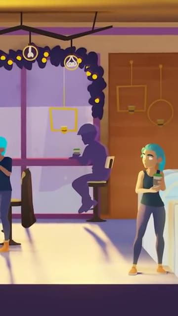

# DramaPlayer

A Swift video playback SDK for UIKit apps that play a single video or a vertically paged feed. Built on AVFoundation, with no third-party runtime dependencies.


[](LICENSE)

[中文接入指南](Docs/Quickstart.zh-CN.md) · [参数与调试参考](Docs/Configuration.zh-CN.md)

| Playback | Integration |
| --- | --- |
| Single-video and vertical-feed views | Optional UIKit controls or a custom UI |
| Play, pause, seek, scrub, rate and buffering progress | Async state, progress and completion events |
| Shared playback focus, with at most one active session by default | Lifecycle handling and host-controlled suspension |
| Bounded AVPlayer reuse and adjacent preloading | Source authorization and a pluggable media cache |
| Poster-to-first-frame transition with a centered loading indicator | Custom cover loaders and AVPlayerLayer presentation |
| Native audio and subtitle selection, bitrate and buffer hints | Startup, rebuffering, cache fallback, and outcome events |

## Run the demo

Open [Demo/DramaPlayerDemo.xcodeproj](Demo/DramaPlayerDemo.xcodeproj) in Xcode, select **DramaPlayerDemo** and run on an iPhone simulator. The featured drama collection bundles 12 vertical excerpts across three open films with a poster for every episode. The playback labs use these film excerpts and a widescreen cut of Charge. See [media credits and licenses](Demo/Media/Series/ATTRIBUTION.md).

| Demo | Try it |
| --- | --- |
| **Drama collection** | Open the featured feed, swipe or auto-advance through 12 episodes, and jump between three stories from the episode picker. Unmute to hear the audio where available. Reopen to resume the last episode. |
| **Single video** | Tap to pause, drag the timeline to seek, change speed, and let the clip loop. |
| **Cover loading** | Compare slow, failed and missing posters, and a video that reaches its first frame before the poster loads. |
| **Landscape video** | Rotate to go full screen. Switch between fitting the whole frame and filling the screen. Enter immersive playback to keep only the progress bar, then tap the picture to restore controls. Swipe on the left for brightness or on the right for volume. |
| **Video layouts** | Preview 12 fit/fill templates with either bundled format. Enter **Mini player**, drag the handle or resize corner, or enter dimensions under **Custom size**. |
| **Vertical feed** | Swipe or select an episode from **Episodes**. Let a clip end to see the feed advance. |
| **Custom controls** | Press **Play** to start from 2 seconds, skip forward, and replay after completion. The host renders its own controls and progress. |
| **Episode access** | Episode 2 starts locked. Press **Unlock episode** to grant demo access and retry. Reopening the example resets the grant. |
| **Cache policies** | Compare Off, Players, Bytes, and Custom. Set how many episodes to prefetch ahead or behind. **Clear cache** removes temporary copies and turns prefetch off until you choose a policy. |
| **Remote playback** | Enter an HTTPS MP4 or HLS URL, or choose **Tears of Steel (HLS)** or **Sintel Trailer (MP4)**. Use **Download video** with MP4 to keep a local copy, then **Delete local copy** to return to streaming. |

See the [playback controller](Demo/Sources/DemoPlayerViewController.swift) for session and lifecycle wiring, and the [cache demo](Demo/Sources/DemoCacheViewController.swift) for a working `PlaybackCacheAdapter` backed by temporary files.

  

## Installation

Use Xcode 15 or later, Swift 5.9 or later, and iOS 16 or later. The Core product also supports macOS 13 or later. The UIKit product is for iOS.

The installation examples below use the released `0.1.1` tag. See [unreleased changes](CHANGELOG.md#unreleased) for the features on `main`. To try them, add a local checkout in Xcode or pin a reviewed commit in a test app.

### Swift Package Manager

In Xcode, choose **File → Add Package Dependencies**, enter `https://github.com/AmiaoCat/DramaPlayer.git`, and select **Up to Next Major Version** from `0.1.1`. Link `ReelsPlaybackCore` for a custom player, or link both `ReelsPlaybackCore` and `ReelsPlaybackUIKit` to use the built-in views.

For a Swift package manifest, add the following dependency and products to the target that uses them.

```swift
dependencies: [
    .package(url: "https://github.com/AmiaoCat/DramaPlayer.git", from: "0.1.1")
],
targets: [
    .target(name: "MyApp", dependencies: [
        .product(name: "ReelsPlaybackCore", package: "DramaPlayer"),
        .product(name: "ReelsPlaybackUIKit", package: "DramaPlayer")
    ])
]
```

### CocoaPods

Add this to your app's Podfile, run `pod install`, and open the generated `.xcworkspace`.

```ruby
platform :ios, '16.0'
target 'MyApp' do
  pod 'DramaPlayer', :git => 'https://github.com/AmiaoCat/DramaPlayer.git', :tag => '0.1.1'
end
```

The pod is distributed from Git tags. Use `DramaPlayer/Core` in the same declaration for Core only. Both subspecs use `import DramaPlayer`. For a local checkout, replace the Git URL and tag with `:path => '../DramaPlayer'`.

### Compatibility with 0.1.1

The product names, imports, public initializer signatures, and session lifecycle entry points still apply. Existing UIKit views still default to `.fill`. Opt in to `scaling: .fit` to preserve the full frame. The preparation deadline is disabled unless you pass `loadTimeout`, and logging is disabled unless you pass a `logger`.

## Quick start

Create one session per playback screen and retain its lifecycle adapter. This view controller works with the built-in controls. Pass a valid local or remote video URL from your app.

```swift
import UIKit
#if canImport(DramaPlayer)
import DramaPlayer
#else
import ReelsPlaybackCore
import ReelsPlaybackUIKit
#endif

@MainActor
final class PlayerViewController: UIViewController {
    private let session: PlaybackSession
    private let lifecycle: PlaybackLifecycle

    init(videoURL: URL, coverURL: URL? = nil) {
        let source = PlaybackSourceResolver { item, _ in
            .allowed(PlaybackSource(url: videoURL, cacheKey: item.id))
        }
        session = PlaybackSession(
            configuration: .init(mode: .single, endBehavior: .loop),
            sourceProvider: source
        )
        lifecycle = PlaybackLifecycle(session: session)
        super.init(nibName: nil, bundle: nil)
        session.setItems([PlaybackItem(id: "video", coverURL: coverURL)])
    }

    required init?(coder: NSCoder) { nil }

    override func loadView() {
        view = SinglePlaybackView(session: session)
    }

    override func viewDidAppear(_ animated: Bool) {
        super.viewDidAppear(animated)
        session.activate()
    }

    override func viewWillDisappear(_ animated: Bool) {
        super.viewWillDisappear(animated)
        session.deactivate()
    }
}
```

See the [integration guide](Docs/Usage.md) for a vertical feed, custom controls, source access, cache policies, and troubleshooting. See [releases](https://github.com/AmiaoCat/DramaPlayer/releases) and the [changelog](CHANGELOG.md) for version history.

## Development

```sh
swift test
xcodebuild -project Demo/DramaPlayerDemo.xcodeproj -scheme DramaPlayerDemo \
  -destination 'generic/platform=iOS Simulator' CODE_SIGNING_ALLOWED=NO build
```

The core tests cover stale selections, retained players, playback focus, cache fallback, and authorization. The [media credits](Demo/Media/Series/ATTRIBUTION.md) include the commands to reproduce the demo clips and posters.

## License

DramaPlayer is available under the [MIT License](LICENSE).
