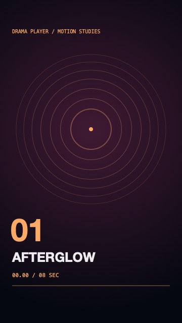
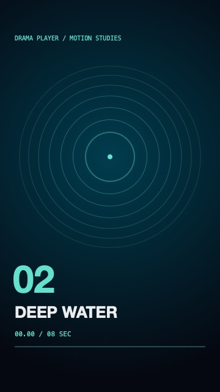
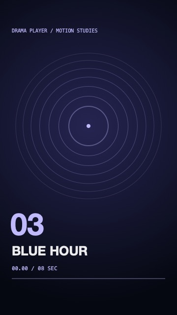

# DramaPlayer

A Swift video playback SDK for UIKit apps that play a single video or a vertically paged feed. Built on AVFoundation, with no third-party runtime dependencies.


[](LICENSE)

| Playback | Integration |
| --- | --- |
| Single-video and vertical-feed views | Optional UIKit controls or a custom UI |
| Play, pause, seek, scrub, rate and buffering progress | Async state, progress and completion events |
| Shared playback focus, with at most one active session by default | Lifecycle handling and host-controlled suspension |
| Bounded AVPlayer reuse and adjacent preloading | Source authorization and a pluggable media cache |
| Poster-to-first-frame transition, with Reduce Motion support | Custom cover loaders and AVPlayerLayer presentation |

## Run the demo

Open [Demo/DramaPlayerDemo.xcodeproj](Demo/DramaPlayerDemo.xcodeproj) in Xcode, select the **DramaPlayerDemo** scheme and run on an iPhone simulator. The project links the local Swift package and includes three original, silent motion studies and matching posters. It works offline.

- **Single video** loops the first clip. Tap the video to pause, drag the timeline to seek, or change the rate.
- **Vertical feed** prepares neighboring clips, advances on completion, and shows the playback state and first-frame status. Swipe to another clip and back to see how a retained player is reused while it remains ready.

  

## Installation

Use Xcode 15 or later, Swift 5.9 or later, and iOS 16 or later. The Core product also supports macOS 13 or later. The UIKit product is for iOS.

### Swift Package Manager

In Xcode, choose **File → Add Package Dependencies**, enter `https://github.com/AmiaoCat/DramaPlayer.git`, and select **Up to Next Major Version** from `0.1.0`. Link `ReelsPlaybackCore` for a custom player, or link both `ReelsPlaybackCore` and `ReelsPlaybackUIKit` to use the built-in views.

For a Swift package manifest, add the following dependency and products to the target that uses them.

```swift
dependencies: [
    .package(url: "https://github.com/AmiaoCat/DramaPlayer.git", from: "0.1.0")
],
targets: [
    .target(name: "MyApp", dependencies: [
        .product(name: "ReelsPlaybackCore", package: "DramaPlayer"),
        .product(name: "ReelsPlaybackUIKit", package: "DramaPlayer")
    ])
]
```

### CocoaPods

Add this to your app's Podfile, run `pod install`, and open the generated `.xcworkspace`.

```ruby
platform :ios, '16.0'
target 'MyApp' do
  pod 'DramaPlayer', :git => 'https://github.com/AmiaoCat/DramaPlayer.git', :tag => '0.1.0'
end
```

The pod is distributed from Git tags. Use `DramaPlayer/Core` in the same declaration for Core only. Both subspecs use `import DramaPlayer`. For a local checkout, replace the Git URL and tag with `:path => '../DramaPlayer'`.

## Quick start

Create one session per playback screen and retain its lifecycle adapter. This view controller works with the built-in controls. Pass a valid local or remote video URL from your app.

```swift
import UIKit
#if canImport(DramaPlayer)
import DramaPlayer
#else
import ReelsPlaybackCore
import ReelsPlaybackUIKit
#endif

@MainActor
final class PlayerViewController: UIViewController {
    private let session: PlaybackSession
    private let lifecycle: PlaybackLifecycle

    init(videoURL: URL, coverURL: URL? = nil) {
        let source = PlaybackSourceResolver { item, _ in
            .allowed(PlaybackSource(url: videoURL, cacheKey: item.id))
        }
        session = PlaybackSession(
            configuration: .init(mode: .single, endBehavior: .loop),
            sourceProvider: source
        )
        lifecycle = PlaybackLifecycle(session: session)
        super.init(nibName: nil, bundle: nil)
        session.setItems([PlaybackItem(id: videoURL.absoluteString, coverURL: coverURL)])
    }

    required init?(coder: NSCoder) { nil }

    override func loadView() {
        view = SinglePlaybackView(session: session)
    }

    override func viewDidAppear(_ animated: Bool) {
        super.viewDidAppear(animated)
        session.activate()
    }

    override func viewWillDisappear(_ animated: Bool) {
        super.viewWillDisappear(animated)
        session.deactivate()
    }
}
```

See the [integration guide](Docs/Usage.md) for a vertical feed, custom controls, source access, cache policies, and troubleshooting. See [releases](https://github.com/AmiaoCat/DramaPlayer/releases) and the [changelog](CHANGELOG.md) for version history.

## Development

```sh
swift test
xcodebuild -project Demo/DramaPlayerDemo.xcodeproj -scheme DramaPlayerDemo \
  -destination 'generic/platform=iOS Simulator' CODE_SIGNING_ALLOWED=NO build
```

The core tests cover stale selections, retained players, playback focus, cache fallback, and authorization. The [demo media generator](Demo/Tools/GenerateMedia.swift) can regenerate the bundled artwork and videos on macOS with `swift Demo/Tools/GenerateMedia.swift Demo/Media`.

## License

DramaPlayer is available under the [MIT License](LICENSE).
